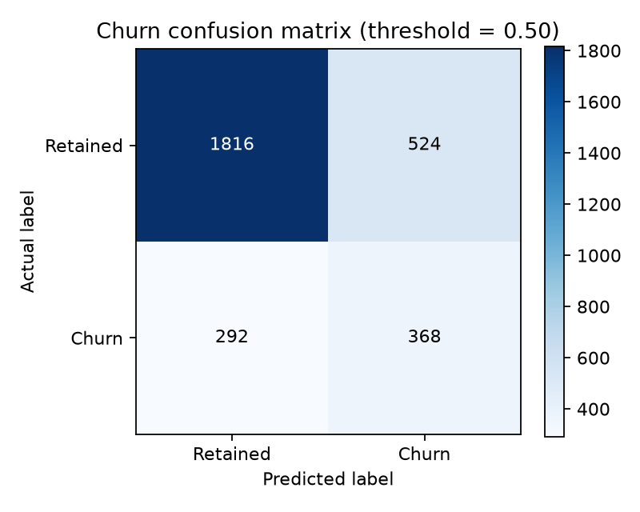
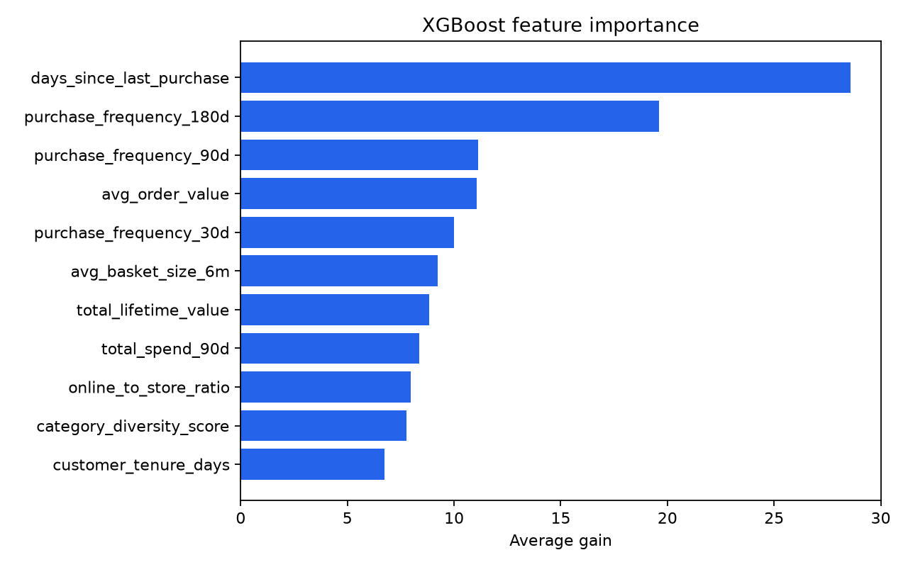

# Lab 3 — Churn Model Evaluation Report

## Result

The final full churn model passed all required evaluation gates on the held-out
test set. Its AUC is higher than the recency-only baseline by 0.0454, and the
paired 95% bootstrap confidence interval for that difference is entirely above
zero. This is evidence that the additional engineered features add predictive
value beyond `days_since_last_purchase`.

| Metric | Your value | Threshold | Result |
| :-- | --: | :-- | :-- |
| AUC-ROC (test set) | 0.7679 | .5 | - |
| Precision @ top 10% | 0.6900 | >= 0.50 | Pass |
| Recall @ top 10% | 0.3136 | >= 0.25 | Pass |
| AUC lift over recency-only baseline | +0.0454; 95% CI [0.0257, 0.0649] | 95% CI excludes zero | Pass |

## Evaluation setup

- **Full model:** XGBoost binary classifier using the 11 feature-engineered
  customer features, including recency, tenure, purchase frequencies, spend,
  basket, category-diversity, and channel-mix features.
- **Baseline:** a separately trained XGBoost model using
  `days_since_last_purchase` alone. It was trained on the same training rows
  and scored on the same test rows as the full model.
- **Split:** stratified 70/30 split with `random_state=42`: 6,999 training
  customers and 3,000 test customers. The test positive rate was 0.2200.
- **Training environment:** local run, XGBoost **3.4.1**; MLflow run
  `fe80fe8aed91439b8b4979d7e9082293` (`xgb-depth8-eta015-final`).
- **Run timestamp:** 2026-10-17 02:45 UTC.

## Baseline comparison and confidence interval

The recency-only model achieved test AUC-ROC **0.7225**. The full model
achieved **0.7679**, a difference of **+0.0454**.

I estimated uncertainty with 2,000 paired bootstrap replicates of the test
set, using seed 42. For each replicate, I resampled the test-row indices with
replacement once, then calculated both the full-model AUC and the baseline AUC
on those same sampled rows. The 2.5th and 97.5th percentiles of
`AUC(full) - AUC(recency-only)` were **0.0257** and **0.0649**. Because this
interval does not include zero, the full model's improvement over recency alone
is measurable at the 95% confidence level.

## Top-decile operating point

The top 10% of scored customers is the intervention list. In that group,
**69.00%** were actual churn cases (precision), and the group captured
**31.36%** of all churn cases in the test set (recall). With a 22% positive
rate, a top-decile program has an approximate recall ceiling of 45%; the
observed recall therefore captures roughly 70% of that budget-limited maximum.

## Evidence

The reported aggregate metrics and interval are recorded in
[`evaluation_metrics.json`](lab3-evidence/evaluation_metrics.json). The MLflow
export in [`mlflow-runs.csv`](lab3-evidence/mlflow-runs.csv) records the
matching final run, parameters, package version, and metrics. Per-tier results
are available in [`slice-evaluation.csv`](lab3-evidence/slice-evaluation.csv);
no loyalty tier was flagged by the configured recall-gap check.

### Confusion matrix

At the selected probability threshold of 0.50, the test-set confusion matrix
contains 1,816 true negatives, 524 false positives, 292 false negatives, and
368 true positives.

### Feature importance

The plot uses XGBoost average gain. `days_since_last_purchase` is the most
influential feature, while the remaining behavioral and value features supply
the incremental signal that lets the full model outperform the recency-only
baseline.

### Loyalty-tier slice evaluation

The following results are saved in
[`slice-evaluation.csv`](lab3-evidence/slice-evaluation.csv). All four tiers
have sufficient sample size under the evaluation rule; no tier is too small to
conclude from.

| Tier | n | Positives | AUC | Recall @ top 10% | Too small to conclude? |
| :-- | --: | --: | --: | --: | :-- |
| Silver | 1,139 | 226 | 0.6952 | 0.2522 | No |
| Platinum | 307 | 21 | 0.8395 | 0.4762 | No |
| Bronze | 1,071 | 361 | 0.7518 | 0.2881 | No |
| Gold | 483 | 52 | 0.7217 | 0.2308 | No |
